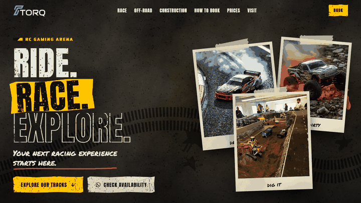

# TORQ — RC Gaming Arena Website

A one-page website for **TORQ**, an RC (remote-control) gaming arena in Kerala, India, with three experiences: an **RC Racing Track**, an **RC Off-Road Track** and an **RC Construction Zone**.

The design is a gritty "raw arena" look: concrete, asphalt and mud textures, worn stencil type, torn paper and hazard tape. Each activity gets its own animated scene.

## Demo

<!-- 🎬 VIDEO: on github.com, edit this README, drag your screen-recording (.mp4) onto this line,
     and GitHub will turn it into an embedded video player. Then delete this comment. -->

| Desktop | Mobile |
|---|---|
|  |  |

*The GIFs scroll through every section. The live site adds the motion: the loading screen, the race fly-by, the bouncing monster truck, the digging excavator and more.*

## Highlights

- **RC-car loading screen**: a buggy drives a dirt-track progress bar based on real asset loading. It is skipped on Data Saver / 2G and shortened on repeat visits.
- **A themed scene per activity**
  - *Race*: start lights, a car fly-by with speed lines, skid marks and screen shake.
  - *Off-road*: a monster truck that follows generated terrain as you scroll, kicking up dust, plus mud splats.
  - *Construction*: an animated excavator that digs and drops sand, sliding caution tape, and a crane that lowers the title.
- **Hand-drawn SVG vehicles** (buggy, monster truck, excavator) built in code and coloured with CSS variables.
- **Booking form → WhatsApp**: a Netlify serverless function sends the request through the WhatsApp Business Cloud API, with a direct-WhatsApp fallback if the server is unavailable.
- **Built for real devices and networks**
  - Responsive images (640 / 1000 / 1472 px WebP).
  - Fonts load without blocking the page.
  - A script-failure safety net, and request timeouts.
  - Off-screen animations pause.
  - `prefers-reduced-motion` is respected.
- **Private details stay private**: the business phone, WhatsApp, Instagram and address are never in this repo. They're injected at deploy time from environment variables.
- **No framework**: plain HTML, CSS and JavaScript.

## Tech

| Part | Used |
|---|---|
| Front end | HTML5, CSS (custom properties, clip-path, masks, keyframes), vanilla JavaScript |
| Backend | Netlify Functions (Node 18+, ES modules) |
| Messaging | Meta WhatsApp Business Cloud API (template messages) |
| Hosting | Netlify (build script, headers, redirects and caching in `netlify.toml`) |
| Assets | Photos enhanced and resized with Python (Pillow + OpenCV); textures generated procedurally |

## Project structure

```
index.html                      the page
style.css                       all styles (theme tokens at the top)
site.js                         behaviour: loader, scenes, scroll effects, booking form
config.example.js               settings template — copy to config.js (git-ignored) and fill in
scripts/make-config.mjs         builds config.js from environment variables on Netlify
404.html                        "Wrong turn" error page
netlify.toml                    hosting config: build, caching, security headers, redirects
netlify/functions/booking.mjs   serverless booking → WhatsApp
assets/                         logos, photos (3 sizes), textures
docs/                           demo GIFs for this README
WHATSAPP-SETUP.md               step-by-step WhatsApp API + Netlify setup
```

## Run it locally

1. Copy `config.example.js` to **`config.js`** and fill in the details (this file is git-ignored).
2. Open `index.html` in a browser, or serve the folder:

```bash
npx serve .
```

To run the booking function locally as well, use the Netlify CLI:

```bash
npm install -g netlify-cli
netlify dev
```

## Editing content

Business details (phone, WhatsApp, Instagram, city, address, opening hours) live in `config.js` locally, or in `TORQ_*` environment variables on Netlify. Track prices and booking time slots are in `config.example.js`. Leave a value empty (`""`) and the site shows "Contact us" instead.

## Deploying

Import this repo into Netlify. It runs `scripts/make-config.mjs` on every deploy. Then add the environment variables listed in [`WHATSAPP-SETUP.md`](WHATSAPP-SETUP.md):

- the `TORQ_*` business details
- the `WA_*` WhatsApp API settings

Access tokens and contact details live only in Netlify. They are never committed.
